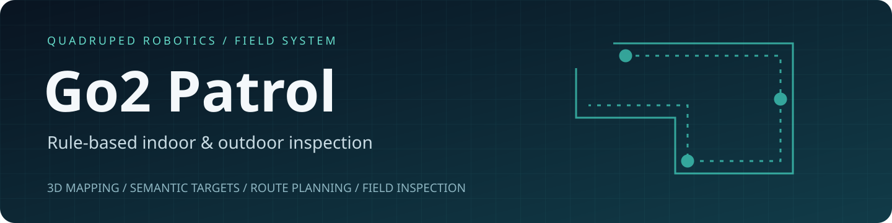
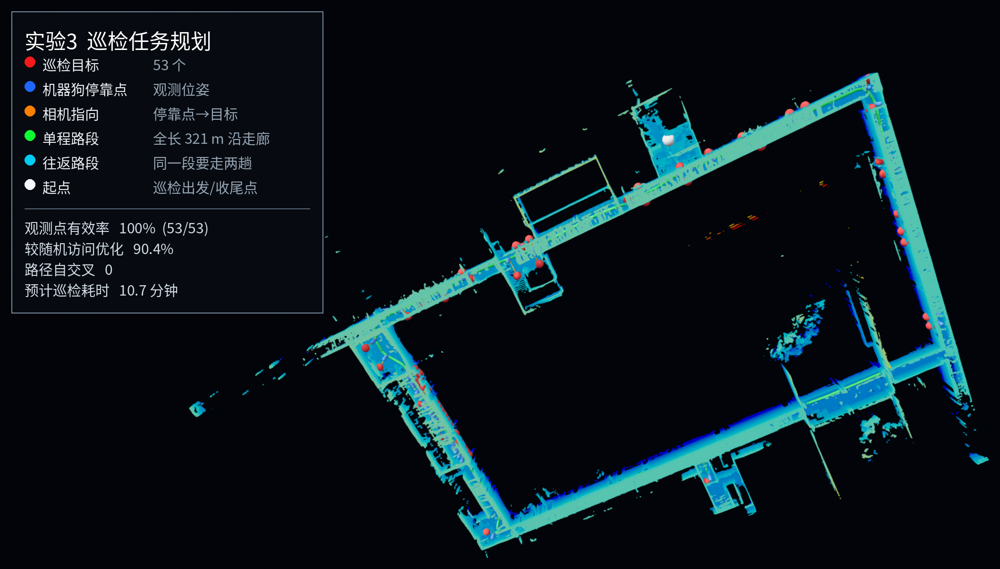
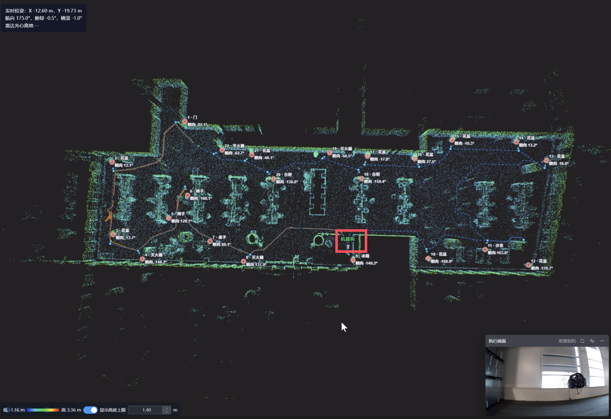
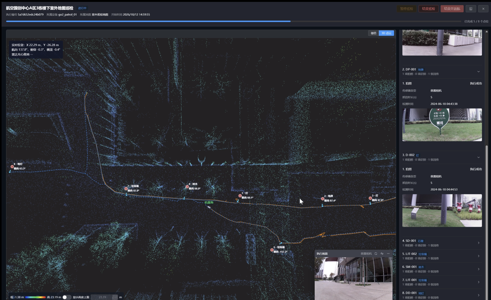
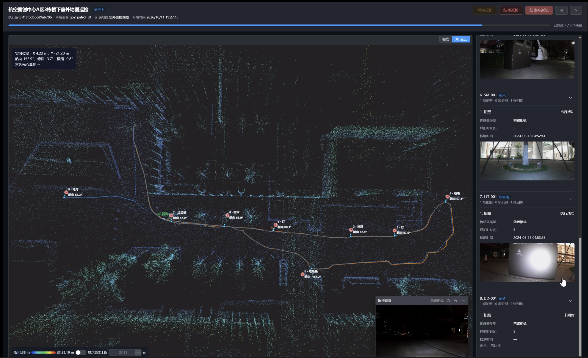
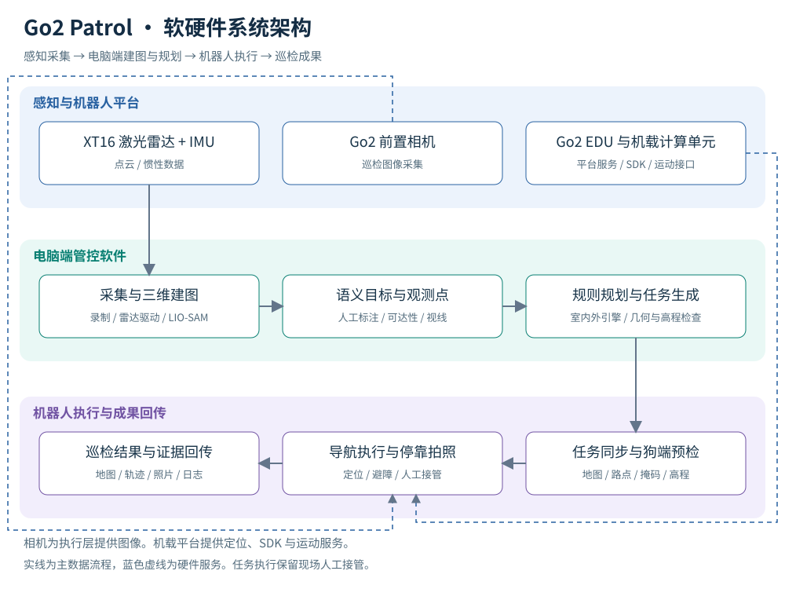

<p align="center"></p>

<h1 align="center">Go2 Patrol · 规则驱动的四足机器人室内外智能巡检</h1>

<p align="center">从三维点云到巡检照片，让地图、任务与现场执行连成一条可追溯的工作流。</p>

<p align="center">


<a href="https://github.com/walmfml88886666/go2-rule-based-inspection/discussions"></a>
</p>

<p align="center"><a href="#项目概览">项目概览</a> · <a href="#成果速览">成果速览</a> · <a href="#软硬件架构">软硬件架构</a> · <a href="#离线代码体验">离线代码体验</a> · <a href="docs/gallery.md">完整画廊</a> · <a href="docs/system.md">技术说明</a></p>

## 项目概览

Go2 Patrol 围绕 **Unitree Go2 EDU + 禾赛 XT16** 构建规则驱动的室内外巡检工作流。系统从点云建立三维地图，在地图上标注检查目标，为目标选择可达观测点并生成任务，由机器人执行导航、停靠拍照和数据回传，最终形成关联地图、轨迹、照片与日志的巡检记录。

<p align="center"><br><sub>项目实机 · Go2 EDU 与外置激光雷达集成</sub></p>

| 环节 | 系统能力 |
| :--- | :--- |
| 三维建图 | 组织点云与 IMU 采集，生成点云地图 |
| 目标标注 | 保存检查目标的位置、类别与编号 |
| 规则规划 | 联合检查可通行区域、观测位置、视线、朝向和路径几何 |
| 巡检执行 | 同步任务配套、狗端预检、导航、停靠拍照 |
| 成果回传 | 关联地图、运行轨迹、目标照片与事件日志 |

本仓库包含系统成果、原项目实拍与软件截图、可编辑软硬件架构图，以及可独立运行的路线几何与访问顺序评估代码。图片对应各自历史实验场次。

## 成果速览

<table>
<tr><th width="50%">三维点云与巡检路线</th><th width="50%">室内实时巡检</th></tr>
<tr><td></td><td></td></tr>
<tr><th>室外日间巡检与照片回传</th><th>室外夜间巡检与照片回传</th></tr>
<tr><td></td><td></td></tr>
</table>

图片来自既有汇报与验收素材，保留原始画面。更多目标标注、室内外规划和巡检结果见 [完整画廊](docs/gallery.md)。

## 软硬件架构



电脑端组织建图、标注与任务生成，机器人端进行预检和现场执行，再将照片、轨迹与日志回传。相机、机载计算单元及厂商平台服务支撑执行层。

架构图提供 [draw.io 可编辑源文件](docs/architecture.drawio)，可在 [diagrams.net](https://app.diagrams.net/) 中打开。模块职责和文件流见 [系统技术说明](docs/system.md)。

## 规则规划如何组织

1. **建立可通行区域**，结合地图地面、高程、障碍和机身几何进行检查。
2. **选择目标观测位置**，检查可达性、目标视线，以及抵达和离开时的朝向。
3. **连接目标并优化顺序**，对最终执行折线检查横穿交叉与重复行走。
4. **生成同源任务配套**，联动核对地图、路点、导航掩码与高程，并在执行前完成狗端预检。
5. **回收现场证据**，将巡检轨迹、目标照片与运行日志关联到对应地图和任务。

室内和室外分别维护规划流程与配套检查。具体规则参数、耗时和运行表现随地图、目标集合、设备及版本记录。

## 离线代码体验

| 模块 | 作用 |
| :--- | :--- |
| [route_intersections.py](tools/route_intersections.py) | 检查执行路线横穿事件，统计共线重复行走 |
| [visit_order_metrics.py](tools/visit_order_metrics.py) | 对固定观测点和有向边代价进行小规模访问顺序穷举评估 |

```bash
git clone https://github.com/walmfml88886666/go2-rule-based-inspection.git
cd go2-rule-based-inspection
python3 -m venv .venv
source .venv/bin/activate
python -m pip install -r requirements.txt
python -m examples.offline_audit
python -m unittest discover -s tests -v
```

示例采用构造路线和代价矩阵，在本地输出横穿事件数量、重复行走长度与访问顺序评估结果。两个算法模块及对应测试取自既有项目代码，保留原内容。输入输出与验证范围见 [技术说明](docs/system.md)。

### 使用容器运行

已安装 Docker 时，可直接拉取并运行 Linux x86_64 离线演示镜像。

```bash
docker pull ghcr.io/walmfml88886666/go2-rule-based-inspection:v0.1.0
docker run --rm --network none ghcr.io/walmfml88886666/go2-rule-based-inspection:v0.1.0
```

镜像内置 Python、依赖和构造数据示例，运行后输出路线检查 JSON。镜像仅用于离线演示。

[版本发布](https://github.com/walmfml88886666/go2-rule-based-inspection/releases) · [容器软件包](https://github.com/users/walmfml88886666/packages/container/package/go2-rule-based-inspection)

## 仓库导航

```text
assets/                   实机照片、软件截图、首页视觉与架构图
docs/architecture.drawio   可编辑的软硬件架构图
docs/system.md             系统流程、实现职责与运行范围
docs/gallery.md            标注、规划、巡检与结果画廊
docs/asset-provenance.json 原图与算法模块来源及 SHA-256
tools/                    原项目离线评估模块
tests/                    对应的既有回归测试
examples/                 可直接运行的离线演示
```

完整系统的 GUI、建图工作区、机器人部署配置与现场数据由原项目维护。本次公开代码覆盖上表中的离线评估部分。

## 交流讨论

欢迎在 [Discussions](https://github.com/walmfml88886666/go2-rule-based-inspection/discussions) 交流室内外巡检、规则规划、任务核验和结果展示。可复现的代码问题可提交 [Issue](https://github.com/walmfml88886666/go2-rule-based-inspection/issues)。发布现场日志前，请移除账号、连接凭据和私密配置。

## 相关项目与资料

- [Unitree ROS 2](https://github.com/unitreerobotics/unitree_ros2) 与 [Unitree SDK 2](https://github.com/unitreerobotics/unitree_sdk2)
- [LIO-SAM](https://github.com/TixiaoShan/LIO-SAM)
- [HesaiLidar ROS 2.0](https://github.com/HesaiTechnology/HesaiLidar_ROS_2.0)
- [Unitree 官方开发者资料](https://support.unitree.com/home/zh/developer)

项目照片与软件截图来自本项目已有材料。厂商名称与商标归各权利人所有。代码授权事项可通过 Discussions 联系维护者。
