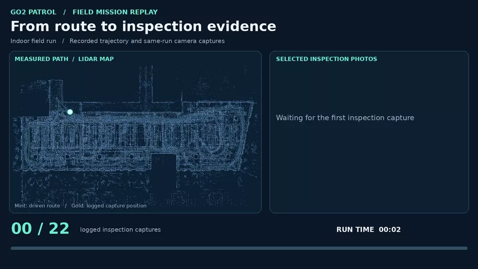
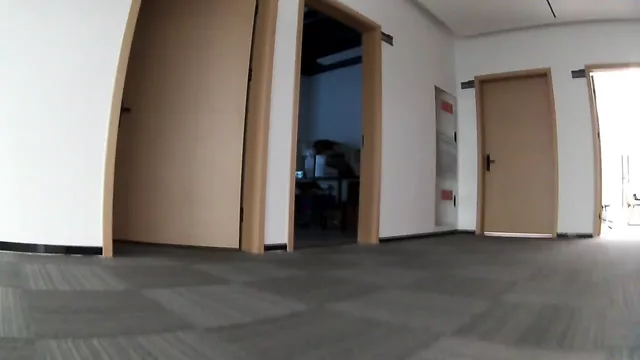
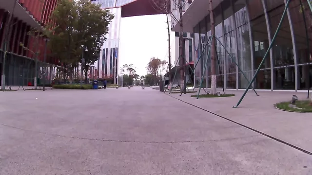
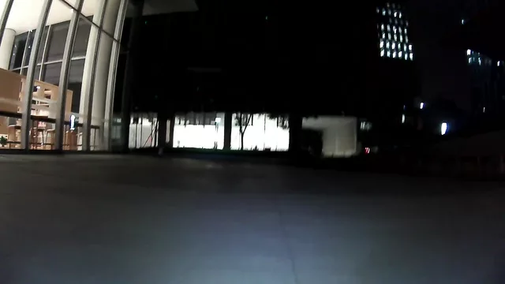
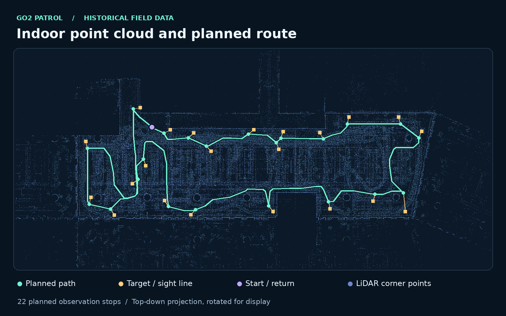
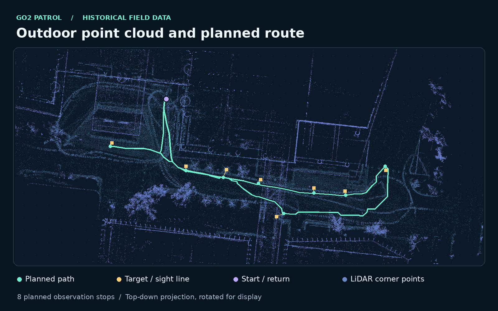
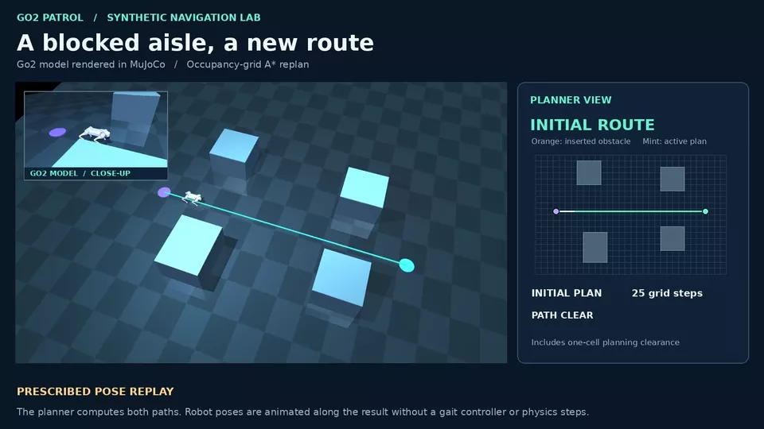
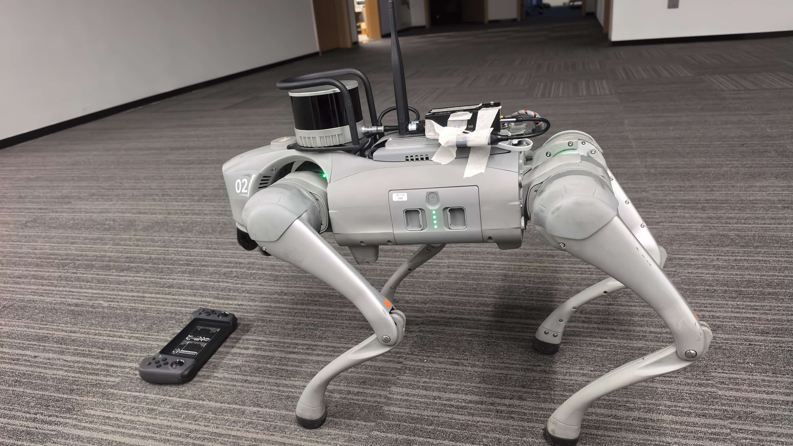
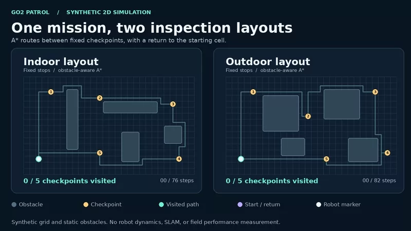

<p align="center"></p>

# Go2 Patrol

**Rule-based indoor and outdoor inspection with the Unitree Go2 EDU.** The field system turns LiDAR maps and annotated targets into inspection routes, then ties robot trajectories, images, and logs back to each mission.

**[Field demos](#field-demos)** · **[3D replanning](#3d-obstacle-replanning)** · **[Architecture](#system-architecture)** · **[Quick start](#quick-start)** · **[Downloads](https://github.com/walmfml88886666/go2-rule-based-inspection/releases/latest)** · **[Discussions](https://github.com/walmfml88886666/go2-rule-based-inspection/discussions)**

## Field demos

### Indoor mission replay

[](https://github.com/walmfml88886666/go2-rule-based-inspection/releases/download/v0.3.0/indoor-mission-replay.mp4)

A recorded indoor mission links the **measured trajectory** to **22 logged photo captures**. The time-compressed replay plots the route over the LiDAR map and shows eight photos at their recorded capture events.

**[Full 1600 × 900 MP4](https://github.com/walmfml88886666/go2-rule-based-inspection/releases/download/v0.3.0/indoor-mission-replay.mp4)** · [High-resolution still](assets/indoor-mission-poster.jpg) · [Field media notes](docs/gallery.md)

### First-person field recordings

These previews open 720p excerpts from three separate field runs.

| **Indoor patrol** | **Outdoor patrol · Day** | **Outdoor patrol · Night** |
| :---: | :---: | :---: |
| [](https://github.com/walmfml88886666/go2-rule-based-inspection/releases/download/v0.2.0/indoor-field.mp4) | [](https://github.com/walmfml88886666/go2-rule-based-inspection/releases/download/v0.2.0/outdoor-day-field.mp4) | [](https://github.com/walmfml88886666/go2-rule-based-inspection/releases/download/v0.2.0/outdoor-night-field.mp4) |

### From point cloud to inspection route

The images below project historical LiDAR corner points, planned routes, and target-to-observation links onto the map plane. The colored paths show the routes planned before each mission. Open either map to inspect the 1600 × 1000 original.

| **Indoor · 22 planned stops** | **Outdoor · 8 planned stops** |
| :---: | :---: |
| [](assets/indoor-field-map.png) | [](assets/outdoor-field-map.png) |

## 3D obstacle replanning

[](https://github.com/walmfml88886666/go2-rule-based-inspection/releases/download/v0.3.0/obstacle-replan-mujoco.mp4)

An obstacle appears in the aisle after six grid steps. A* recomputes the rest of the path and reaches the goal in **31 total grid steps**, up from 25 on the original plan. The scene renders a prescribed Go2 pose along the computed route in MuJoCo.

**[Full 1600 × 900 MP4](https://github.com/walmfml88886666/go2-rule-based-inspection/releases/download/v0.3.0/obstacle-replan-mujoco.mp4)** · [High-resolution still](assets/obstacle-replan-poster.jpg) · [Run the planner](#quick-start) · [Scenario details](docs/simulation.md)

## System architecture

<p align="center">
  <br>
  <sub>Field platform · Go2 EDU with Hesai XT16 LiDAR</sub>
</p>

[](assets/architecture.svg)

1. **Map the site.** Record LiDAR and IMU data and build a point cloud with the project's ROS 2 / LIO-SAM workflow.
2. **Annotate inspection targets.** Record each target's position, category, and identifier on the map.
3. **Plan a mission.** Check traversability, elevation, robot footprint, camera line of sight, and visit order before exporting waypoints and their matching map layers.
4. **Run the inspection.** Sync the mission bundle, run onboard preflight checks, then navigate to observation poses and capture images.
5. **Review the evidence.** Associate the trajectory, target images, and event logs with the original map and mission.

**[System notes](docs/system.md)** · **[Editable draw.io diagram](docs/architecture.drawio)** · **[Field media and data provenance](docs/gallery.md)**

## 2D simulation

[](https://github.com/walmfml88886666/go2-rule-based-inspection/releases/download/v0.2.0/grid-simulation.mp4)

A lightweight 2D example runs A* between five fixed checkpoints in each of two synthetic layouts. It checks that the route visits every stop in order, avoids all blocked cells, and returns to its starting cell. The example models static grid geometry and waypoint motion. It does not model quadruped dynamics, live SLAM, or real-world safety.

**[Watch 720p MP4](https://github.com/walmfml88886666/go2-rule-based-inspection/releases/download/v0.2.0/grid-simulation.mp4)** · **[Scenario source](examples/grid_simulation.py)** · **[Simulation details](docs/simulation.md)**

## Quick start

Run the planners with Python 3.11 or a compatible Python 3 version. The examples use the standard library.

```bash
git clone https://github.com/walmfml88886666/go2-rule-based-inspection.git
cd go2-rule-based-inspection
python3 -m examples.grid_simulation indoor
python3 -m examples.grid_simulation outdoor
python3 -m examples.obstacle_replan
```

The [public Linux x86-64 image](https://github.com/walmfml88886666/go2-rule-based-inspection/pkgs/container/go2-rule-based-inspection) includes the route audit, grid simulator, and obstacle-replanning example.

```bash
image=ghcr.io/walmfml88886666/go2-rule-based-inspection:v0.3.0
docker run --rm --network none "$image"
docker run --rm --network none "$image" python -m examples.obstacle_replan
```

<details>
<summary>Run the route audit and regression tests locally</summary>

```bash
python3 -m venv .venv
source .venv/bin/activate
python -m pip install -r requirements.txt
python -m examples.offline_audit
python -m unittest discover -s tests -v
```

</details>

The [route geometry module](tools/route_intersections.py) detects crossings and measures collinear retracing. The [visit-order audit](tools/visit_order_metrics.py) enumerates feasible orderings for small sets of fixed observation stops. The full field GUI, ROS workspace, vehicle configuration, deployment software, and raw site data are maintained with the original project.

## References and discussion

Hardware and software references: [Unitree Go2](https://www.unitree.com/go2/) · [Unitree ROS 2](https://github.com/unitreerobotics/unitree_ros2) · [Unitree SDK 2](https://github.com/unitreerobotics/unitree_sdk2) · [Hesai ROS driver](https://github.com/HesaiTechnology/HesaiLidar_ROS_2.0) · [LIO-SAM](https://github.com/TixiaoShan/LIO-SAM).

Use [Discussions](https://github.com/walmfml88886666/go2-rule-based-inspection/discussions) for questions about the system and [Issues](https://github.com/walmfml88886666/go2-rule-based-inspection/issues) for reproducible problems with the public examples. Contact the maintainer before redistributing project media or code.
