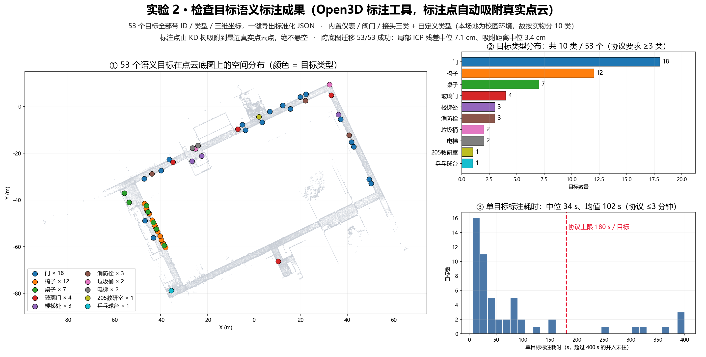
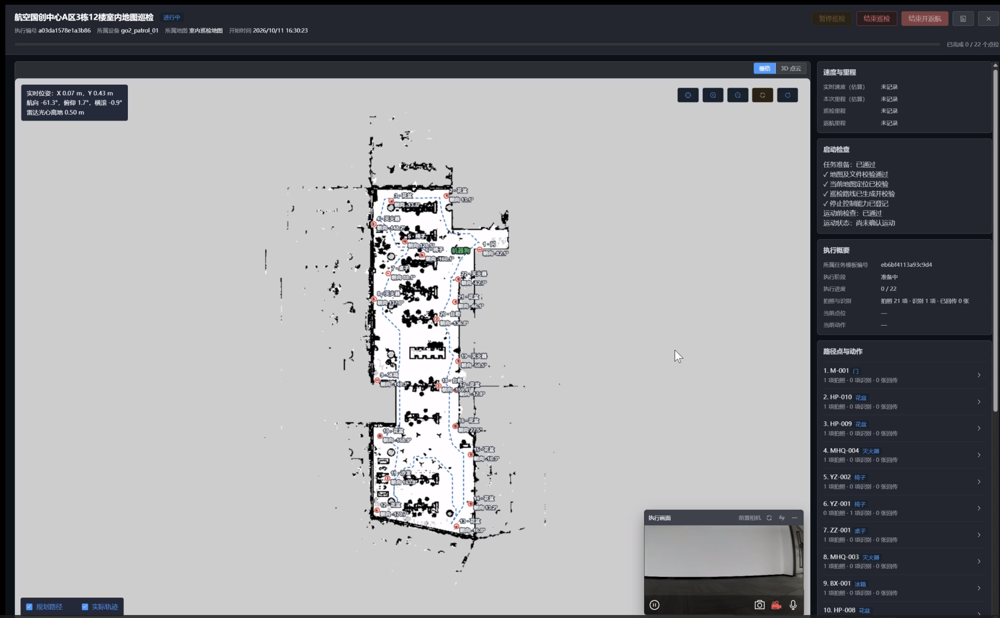
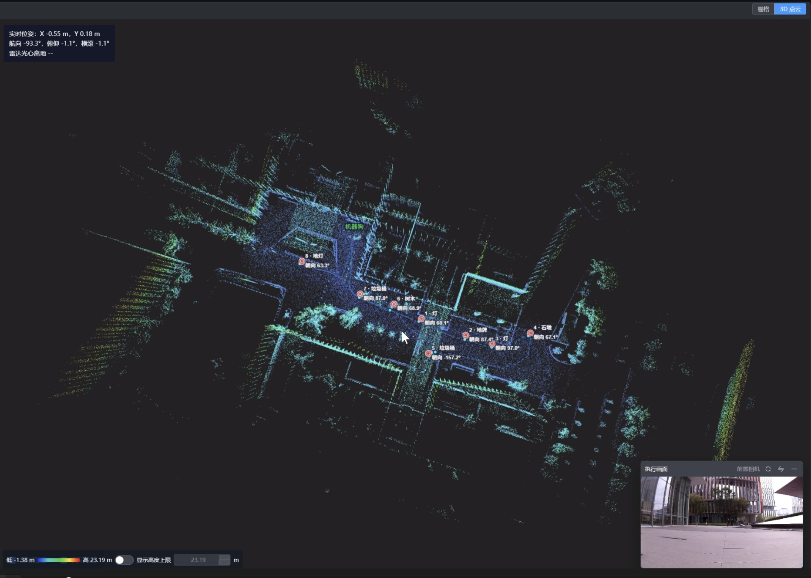
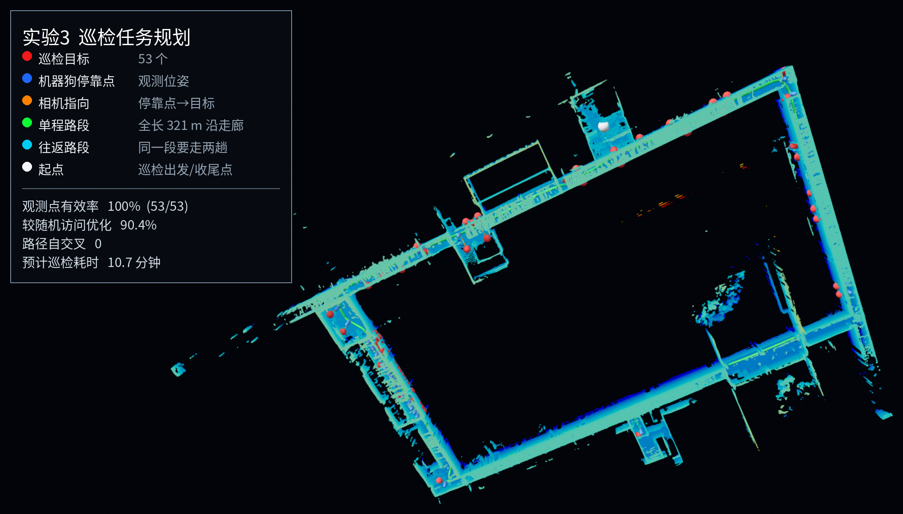
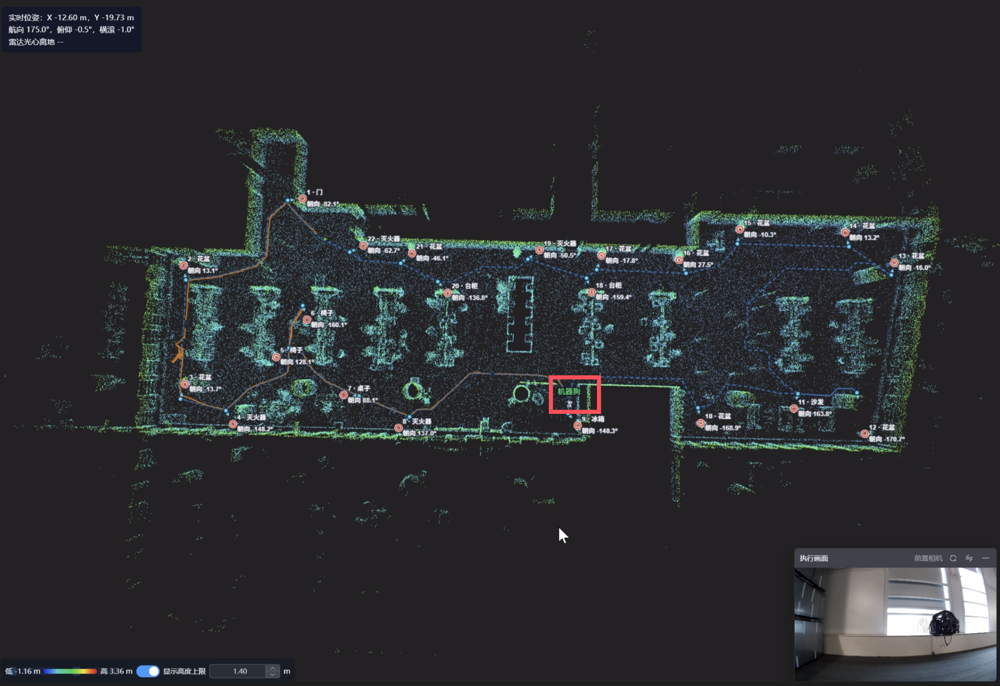
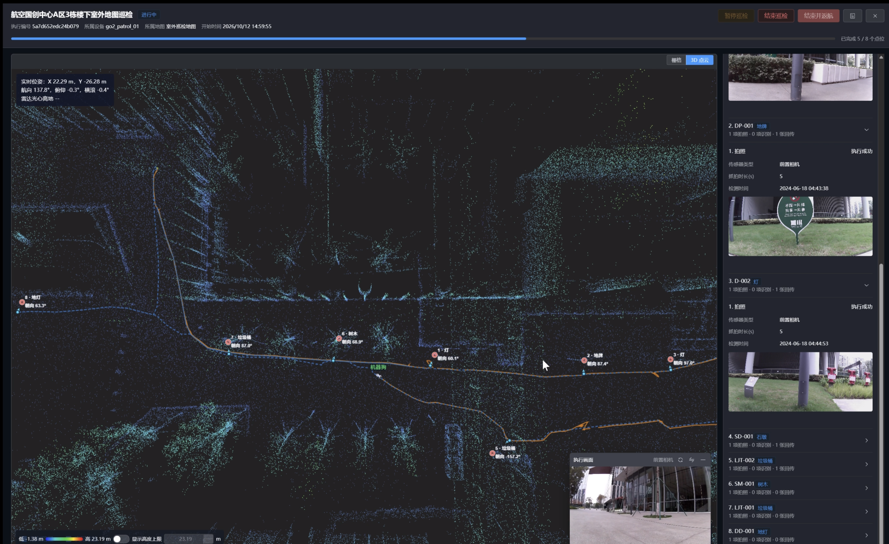
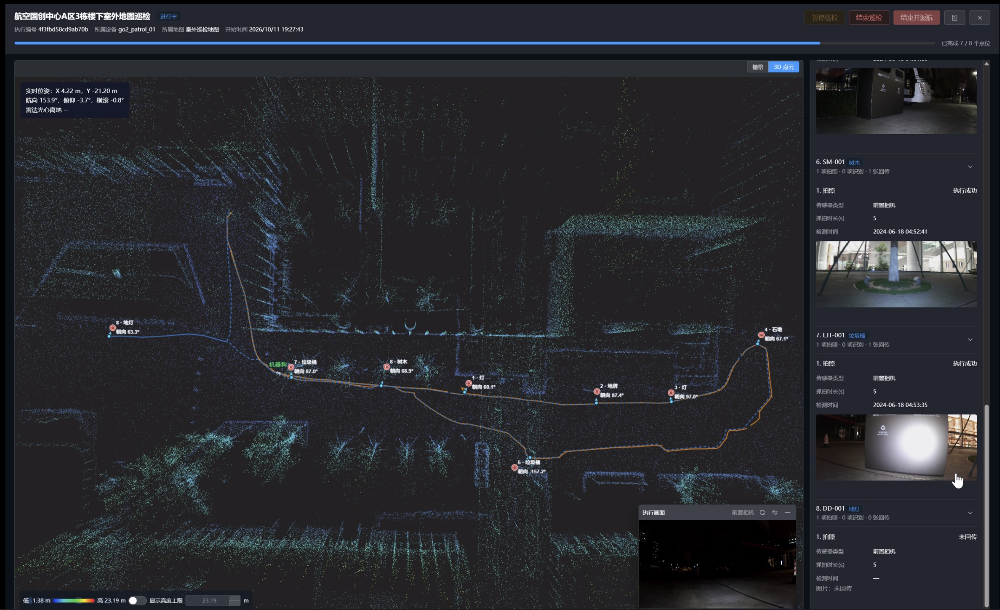
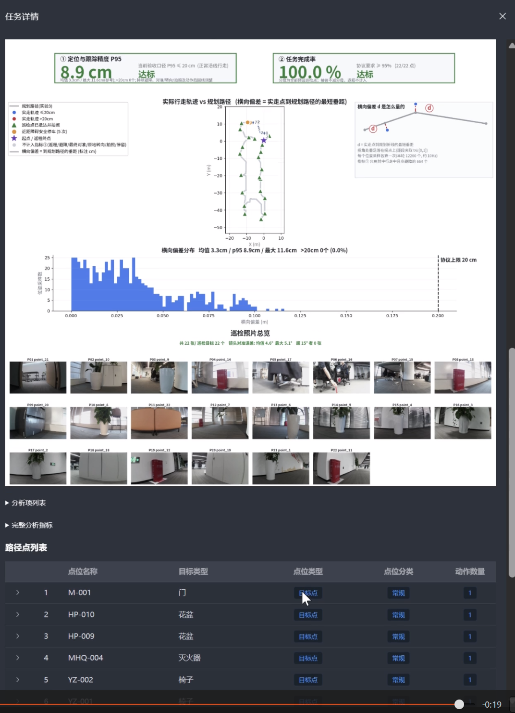
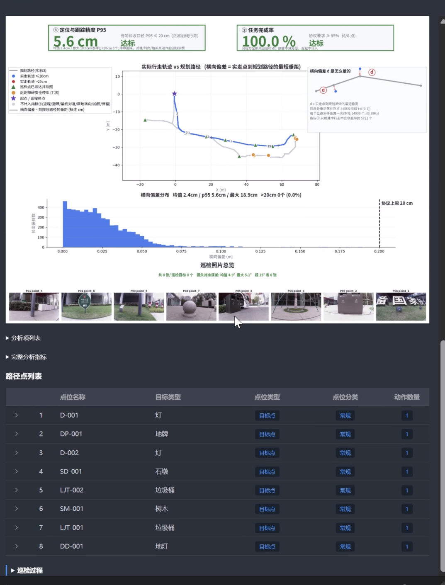

# 成果画廊

本页按实验环节展示既有室内外巡检成果，保留原始画面。

## 地图目标标注

历史点云标注成果图，展示目标分布、编号和类别统计。

## 室内外任务规划

| 室内场景 | 室外场景 |
| :---: | :---: |
|  |  |

三维规划视图关联点云地图、语义目标与巡检路线。

## 室内巡检

巡检过程在点云地图上实时显示。

## 室外日间与夜间巡检

日间巡检中的目标照片回传。

夜间巡检中的目标照片回传。

## 巡检结果

| 室内巡检结果 | 室外巡检结果 |
| :---: | :---: |
|  |  |

结果界面关联运行路径、曲线、目标照片及相关记录。各图数值来自各自历史实验，评价时应核对对应地图、日志、目标集合与统计口径。

[回到项目首页](../README.md)
