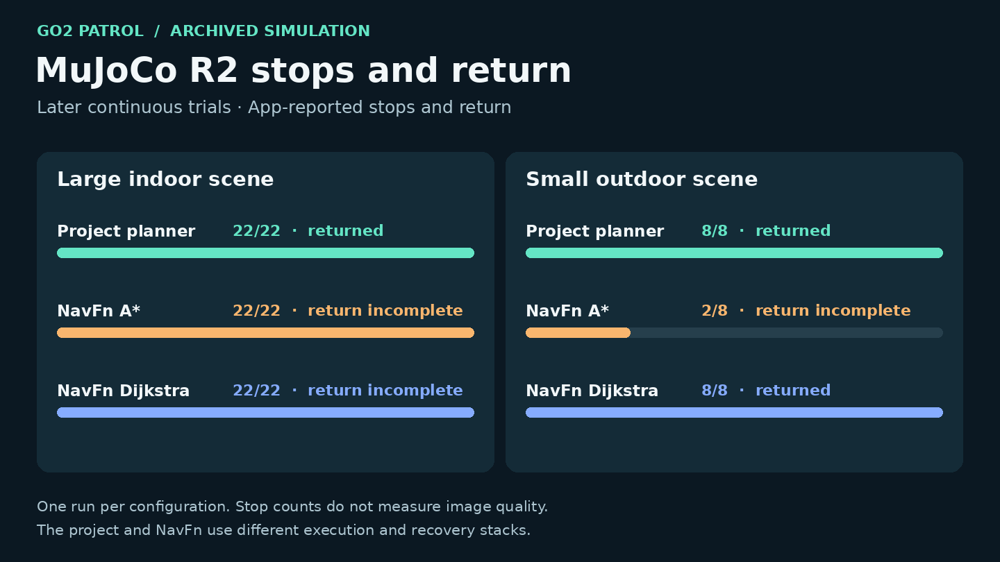
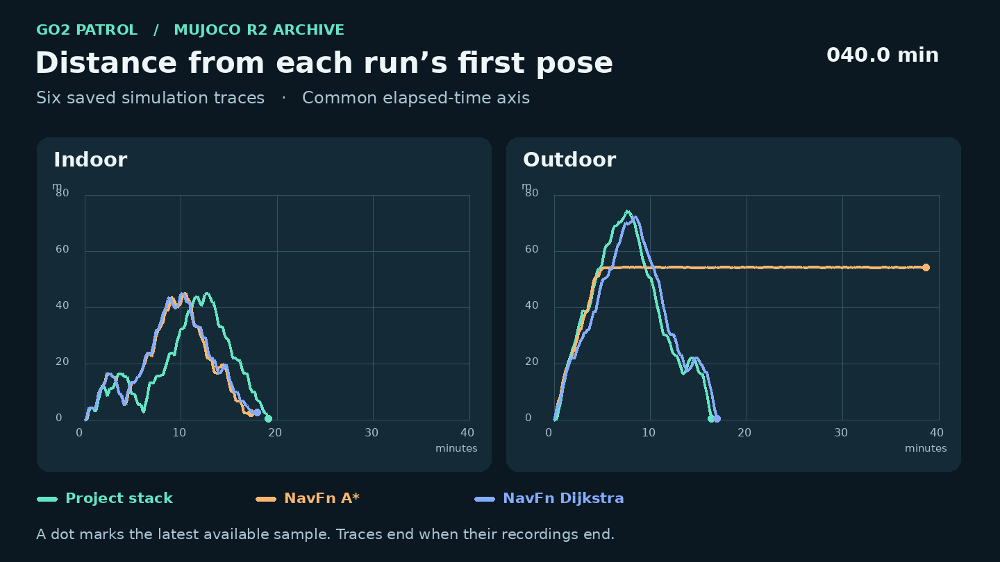

# Archived navigation comparison

Two point-cloud-derived scenes were used to compare the project navigation stack with ROS 2 NavFn in A* and Dijkstra modes. The table preserves three distinct measurements from the October 2026 archive. See the [aggregate data and source hashes](data/archived-comparison.json).

| Scene | System | Planned distance incl. return | Earlier Gazebo stops | MuJoCo R2 stops | R2 return reported | R2 final offset from departure |
| --- | --- | ---: | ---: | ---: | --- | ---: |
| Indoor | Project planner and executor | 185.19 m | 4/22 | 22/22 | Yes | 0.402 m |
| Indoor | NavFn A* | 206.94 m | 1/22 | 22/22 | No | 2.243 m |
| Indoor | NavFn Dijkstra | 205.83 m | 1/22 | 22/22 | No | 2.644 m |
| Outdoor | Project planner and executor | 229.45 m | 0/8 | 8/8 | Yes | 0.362 m |
| Outdoor | NavFn A* | 249.02 m | 0/8 | 2/8 | No | 54.344 m |
| Outdoor | NavFn Dijkstra | 247.52 m | 0/8 | 8/8 | Yes | 0.369 m |

- **Planned geometry** uses the same observation stops, visit order and return leg. All plans supplied paths for all 23 indoor or 9 outdoor legs. The values are planned lengths, independent of how far a simulated robot actually traveled.
- **Earlier continuous execution** used Gazebo Fortress and Go2/CHAMP with simplified sensing and ideal localization. The outdoor rows use the corrected common spawn. The invalid-start trials are excluded. This round and R2 used different physical and control setups.
- **MuJoCo R2** used a common Go2 model and experimental velocity feedback adapter, with ideal localization and a placeholder camera. R2 tested each whole-system profile once per scene with the frozen inputs. The two NavFn profiles differ by [`use_astar`](https://github.com/ros-navigation/navigation2/blob/humble/nav2_navfn_planner/src/navfn_planner.cpp). The project stack uses Dijkstra graph search with its own costs, route processing, execution and recovery. Stop counts are application reports. Image quality was outside this test.
- **Return and stop counts** measure different outcomes. All three indoor profiles reported every point, while only the project stack reported a completed return. The final offset is measured from the navigation departure pose and is separate from the program's return status.

These are six conditional runs per simulation round. Repeated trials and a shared execution and recovery stack across all profiles would be needed to estimate reliability and isolate the effect of search choice. Field results are reported separately in the [gallery](gallery.md).

## See how the six runs progressed

[Play the 14-second comparison](../assets/archived-distance.mp4?raw=1) · [Download the derived trace data](data/archived-relative-distance.json)

The time plot shows horizontal distance from the first recorded pose, sampled approximately every ten simulation seconds plus the last available sample. It does not show odometry length. The first record and the navigation departure reference in the table differ slightly. The outdoor A* trace remains far from its first pose when recording stops. The public plot contains scalar distances and timestamps with no site coordinates, point clouds, or imagery.
