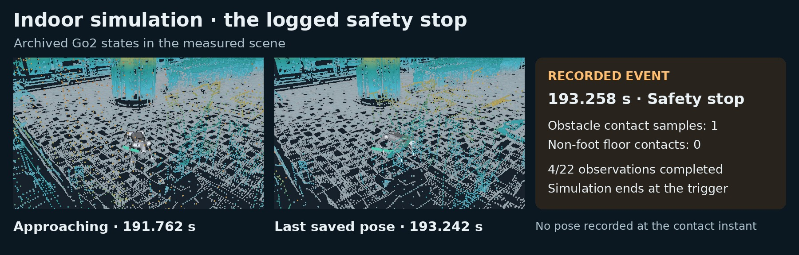
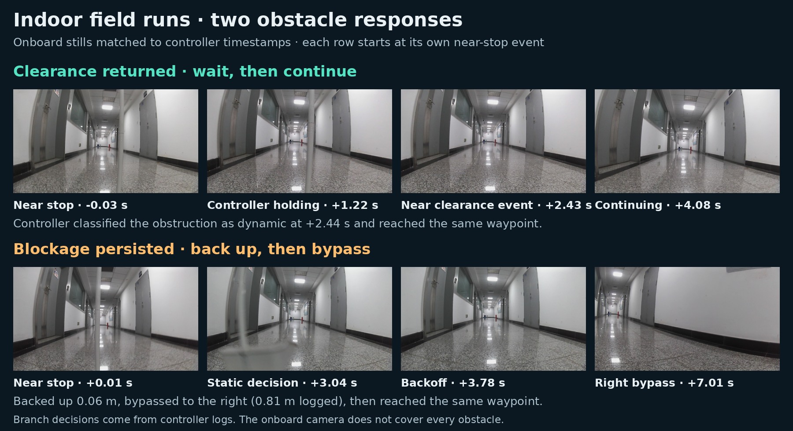

# Indoor safety stop and field obstacle response

The measured-map simulation and the field controller handle different conditions. The archived MuJoCo run ends at the safety trigger. The separate field runs continue after the controller detects renewed clearance or completes a bypass.

## Contact stop in the indoor simulation



| Simulation time | Evidence |
| ---: | --- |
| 2–13 s | The early README replay shows ordinary navigation. |
| 187.620 s | Fourth capture recorded. |
| 193.242 s | Last saved pose, 16 ms before the event. |
| 193.258 s | `safety_stop`. One obstacle contact sample, zero non-foot ground contact samples and 2.16° body tilt. The simulation ends after 4 of 22 observations. |

The [event record](data/slam-physics-results.json) identifies the trigger. The [simulation loop](../examples/slam_patrol.py) counts robot-to-obstacle contacts separately from normal foot-to-ground contacts and ends the run when its stop condition is met. The archived pose sampling did not preserve the contact instant or a subsequent stationary state. The display points provide scene context and do not locate the exact contact. This run does not execute the field wait or bypass logic.

## Wait or bypass in the field



The field controller pauses for a near obstruction and checks whether it continues to block the route. If clearance returns during the observation window, the controller can resume toward the same waypoint. When a blockage persists, the controller can classify it as static, back up and take a local bypass before continuing. The two sequences show independent indoor runs. Times are relative to each near stop.

| Elapsed | Clearance returned | Blockage persisted |
| --- | --- | --- |
| +0.00 s | Near-obstacle stop | Near-obstacle stop |
| About +2.0 s | Still holding | Still holding |
| +2.44 s / +3.02 s | Controller logs dynamic classification and clearance restored | Controller logs static classification and starts backing up |
| +3.79 to +11.79 s | — | Backoff of 0.06 m completes. Right bypass starts and reports 0.81 m of movement before completing. |
| +7.68 s / +17.46 s | Same waypoint reached | Same waypoint reached |

The [relative event times and source identifiers](data/field-obstacle-response.json) come from controller logs. The onboard images show the robot's viewing direction and surroundings. The log labels describe how the controller interpreted persistence and clearance, rather than independently measured obstacle motion.

## Reproduce the evidence figures

With the archived indoor simulation inputs, robot model and run directory, use the optional renderer dependencies in the [display notes](visual-comparison.md#reproduce-the-enlarged-patrol-view).

```bash
python -m examples.render_stop_evidence --inputs /path/to/verified-inputs \
  --robot-xml /path/to/unitree-go2.xml --run /path/to/archived-indoor-run \
  --output assets/slam-indoor-stop.jpg
```

For the field storyboard, select the camera frame nearest each recorded time, relative to the corresponding `near_collision_stop` in the specified log. The JSON lists the selected frame times. Save the stills under the filenames in the JSON and run:

```bash
python -m tools.render_field_obstacle_evidence \
  --record docs/data/field-obstacle-response.json --frames /path/to/selected-stills \
  --output assets/field-obstacle-response.jpg
```
