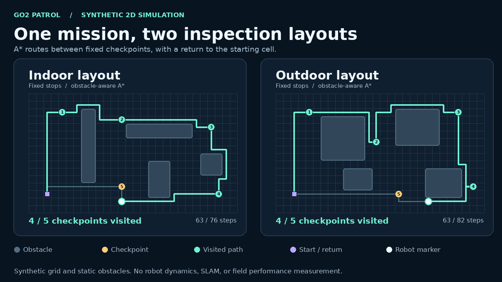

# Synthetic grid simulation

The public example isolates one aspect of rule-based inspection: routing between known observation stops while respecting blocked areas. The two synthetic layouts use rectangular obstacles and a 28 × 16 grid. A four-connected A* search with a Manhattan heuristic computes each leg. The stop order is fixed, and the last leg returns to the initial cell. The simulation demonstrates geometry and visit progression; it does not test the field planner or any physical robot.

[](../assets/simulation-poster.png)

| Scene | Checkpoints visited | Path length | Final state |
| --- | ---: | ---: | --- |
| Indoor | 5 / 5 | 76 grid steps | Returned to start |
| Outdoor | 5 / 5 | 82 grid steps | Returned to start |

```bash
python3 -m examples.grid_simulation indoor > indoor-route.json
python3 -m examples.grid_simulation outdoor > outdoor-route.json
```

Each JSON result contains the obstacles, ordered stops, arrival indices, and the complete cell-by-cell route. The program checks obstacle clearance, adjacency, stop order, and return to start before returning the result. A grid step is one cell transition, with no physical unit or speed assigned.

[Download the 720p simulation](https://github.com/walmfml88886666/go2-rule-based-inspection/releases/download/v0.2.0/grid-simulation.mp4) · [Back to the README](../README.md)
