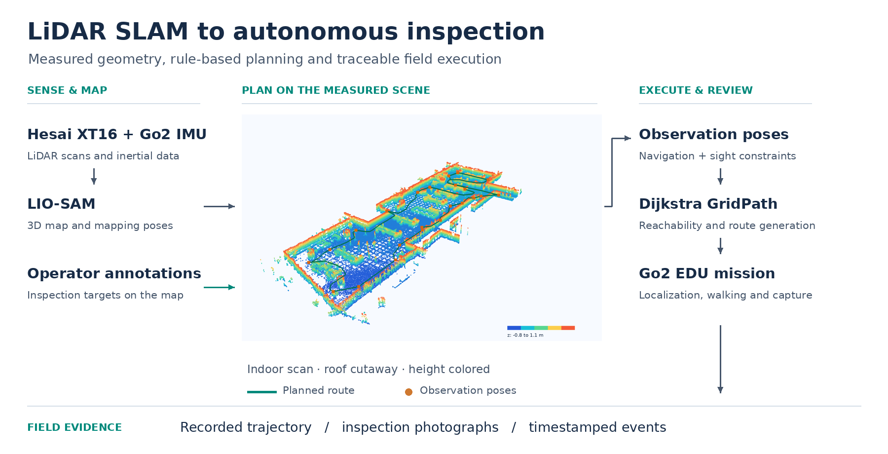
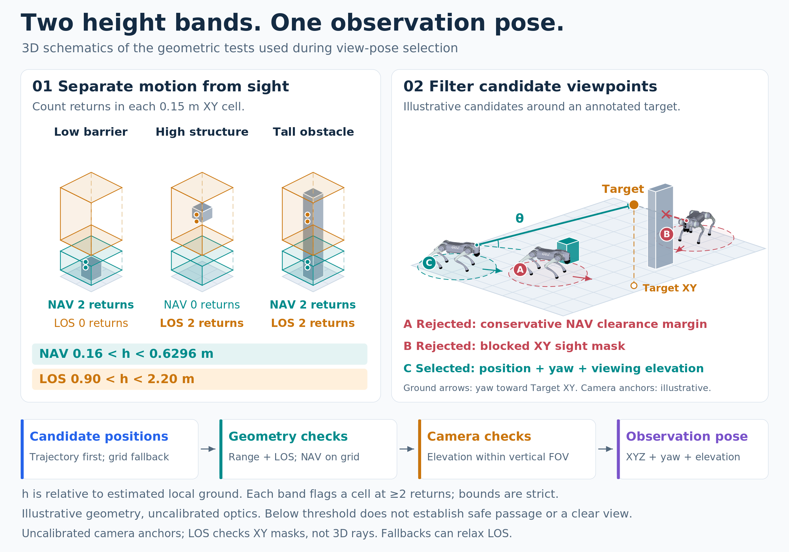
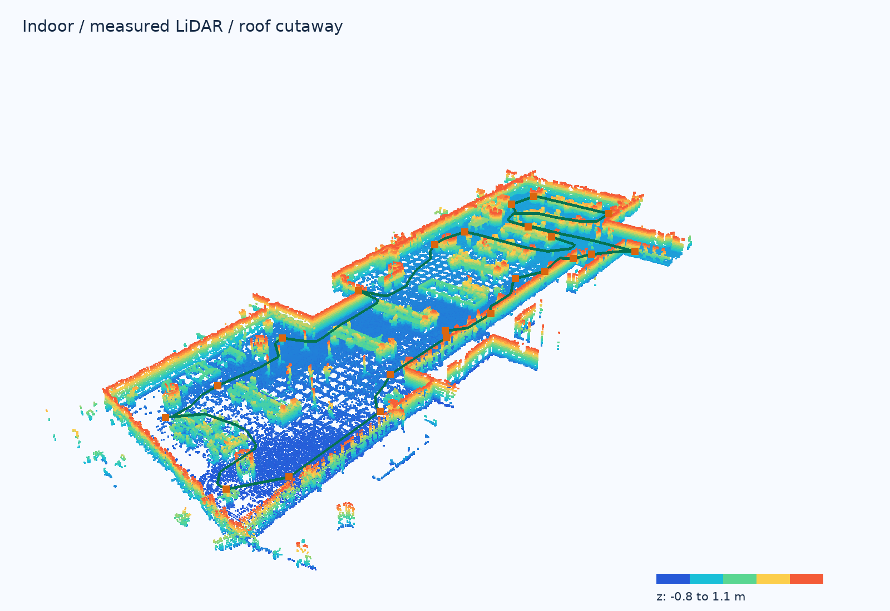

# 3D rendering methods and comparisons

## System architecture



## Planning layers



## Camera-angle comparison

The original point positions are height-colored and viewed from oblique cameras. Left and right columns compare 35° and 65° camera elevations. These are visualization candidates from the original localization maps.


## Selected scene views

The architecture uses a common light background and a roof cutaway. The two layers have more separation, physical obstacle examples, and an explicit grid pitch. The measured scene views below use 35° oblique cameras, display-only sparse-cell filtering and per-scene height colors.




## Rendering backends


| Backend / preset | What is displayed | Visual assessment |
| --- | --- | --- |
| OpenGL point rendering | Measured XYZ returns with height colors | Preserves scan detail and works well in the orbit previews |
| VTK point splats | Display-filtered returns rendered as small Gaussian footprints | Softer edges, but light backgrounds reduce contrast |
| VTK eye-dome lighting | Depth shading applied to the point splats | Stronger depth boundaries, with reduced color clarity in this preset |
| VTK Gaussian surface | An isosurface derived from point-density splatting | More continuous silhouettes, but sampling can create or close gaps |
| MuJoCo | Existing robot states on archived collision geometry | Shows the robot dynamics and recent simulated path |

These are visual comparisons of rendering presets, including different display sampling. The VTK density surface is a visualization reconstruction. Physics replay uses the archived collision model and state arrays.

The 3D scene tours retain cells with at least two returns in a 0.18 m voxel for display. The indoor cutaway removes points above the scene's fifth-percentile Z plus 1.9 m. Each scene is colored using its retained second to ninety-eighth percentile Z, with a numeric color legend. Planned XY paths and observation points are drawn as reference overlays on a horizontal plane.

The paired patrol view uses finite returns in its fixed scene context, with the same fifth-percentile-Z-plus-1.9-m cutaway applied to the indoor view, while the local dynamics pane displays the original collision terrain with height colors. Mission results refer to the full recorded run. The visible excerpts remain indoor 2–13 s and outdoor 110–121 s at 1×.

## Reproduce the scene tours

With the original verified input archive and optional MuJoCo/PyOpenGL/Pillow dependencies available:

```bash
python -m examples.render_scene_tour --inputs /path/to/verified-inputs --output /path/to/output --ffmpeg /path/to/ffmpeg
```
