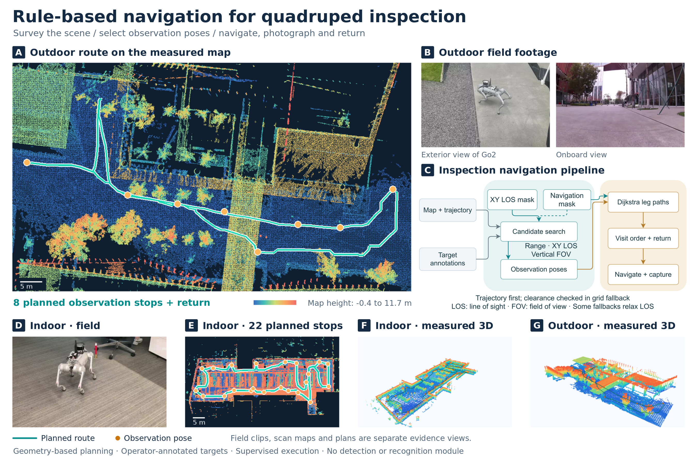
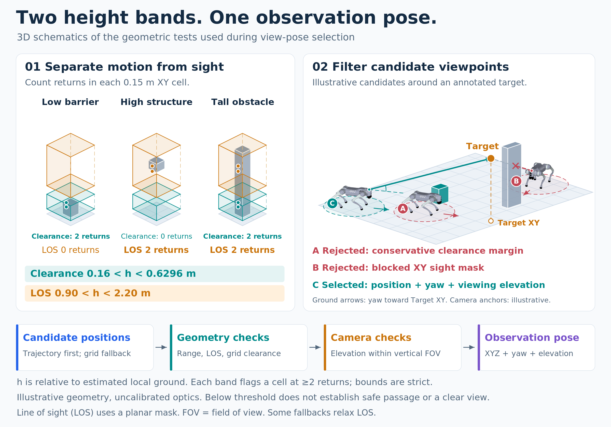
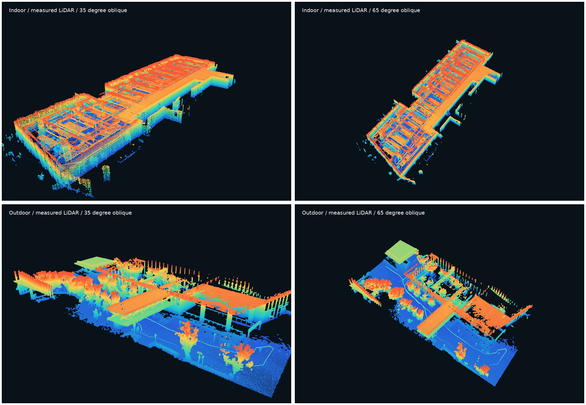
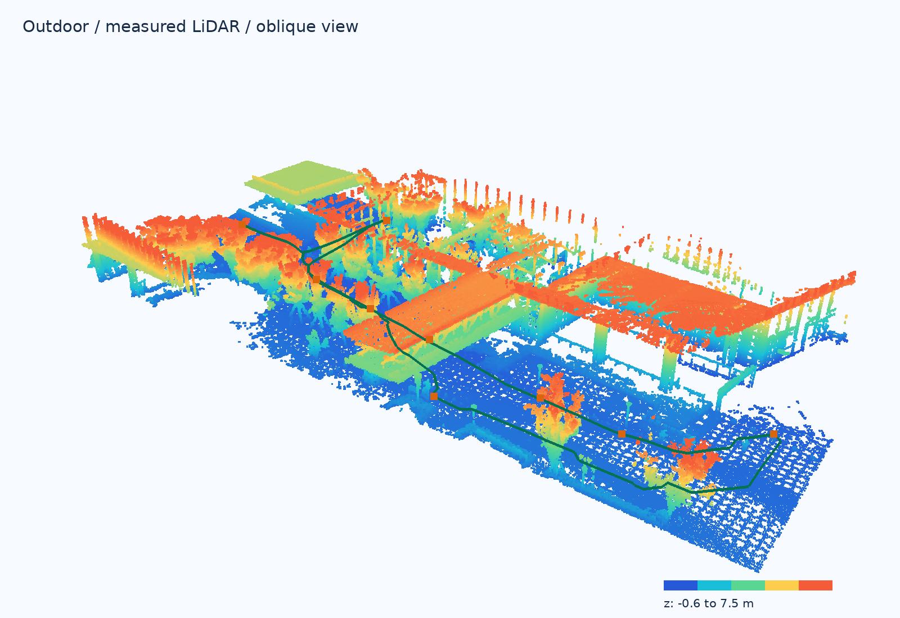
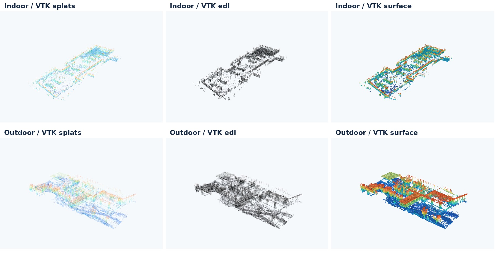
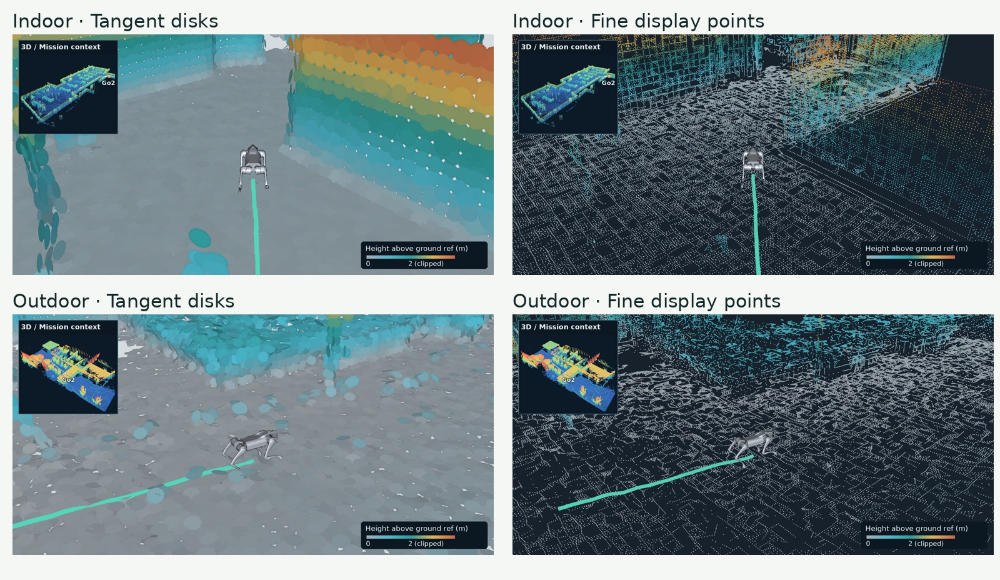
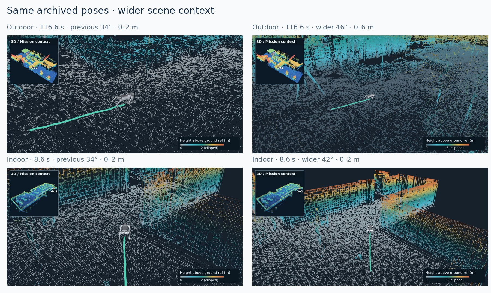

# 3D rendering methods and comparisons

## System architecture



[Editable composition](system-overview.drawio) · [Native workflow master](inspection-workflow.drawio) · [SVG export](../assets/system-overview-9719c94521e3.svg)

## Planning layers



[Editable draw.io master](navigation-sight-principle.drawio) · [SVG export](../assets/navigation-sight-layers-691464739e08.svg)

Three illustrative 3D columns show a low barrier, a higher obstruction and a tall obstacle inside separate translucent clearance and line-of-sight (LOS) height volumes. The right-hand diagram shows candidate poses rejected by stance clearance or a blocked sight check, alongside a selected viewing direction. The floor footprints and vertical projection lines are schematic; scene distances and mesh dimensions use a common projection scale. Each band uses strict endpoints and an independent threshold of at least two returns. A below-threshold count does not establish traversability or visibility by itself. [The selection notes](mapping.md#observation-pose-selection) explain trajectory-first candidates, camera checks and relaxed fallback stages. Three grounded Go2 mesh renders show rejected grid candidate A, LOS-rejected candidate B and selected pose C. Ground arrows show yaw. The rising camera-to-target lines begin at illustrative front-camera anchors attached to the robot bodies; the target is above them. These anchors are explanatory, not calibrated camera extrinsics. The implementation checks an XY ray through the height-band mask, not a 3D optical ray.

## Camera-angle comparison

The original point positions are height-colored and viewed from oblique cameras. Left and right columns compare 35° and 65° camera elevations. These are visualization candidates from the original localization maps.



## Selected scene views

The overview follows a white-background scientific multi-panel layout: a dominant measured outdoor map with the planned route and eight observation stops, smaller exterior and onboard field views, a native draw.io workflow and four aligned panels showing indoor field footage, an indoor route and indoor/outdoor measured 3D scenes. These images come from already published project media, not a new synchronized experiment. The compact flow shows the navigation mask feeding route paths and a dashed grid-only candidate input, LOS and candidate selection, then observation poses, Dijkstra paths, visit order/return planning and supervised navigation/capture. Detailed trajectory-first and relaxed-LOS behavior remains in the mapping notes. Point-cloud colors encode height, not object semantics; panel A includes its own low-to-high map-Z color ramp, while the original scene figures retain their numeric height scales. Route-map distance bars remain metric. The principle diagram uses one orthographic basis for the original-material Go2 meshes, ground, obstacles and attached illustrative camera anchors, with uniform sprite scaling. Ground arrows follow the model +X heading toward the explicitly marked Target XY ground point. The elevated target projects elsewhere on screen; rotating a mesh toward its elevated screen location would corrupt the correct yaw. The elevated target ray describes viewing elevation, not mechanical camera pitch or calibrated optics. A conservative clearance buffer rejects A without intersecting its physical mesh; B's XY segment meets the wall; C's segment avoids both obstacles. Camera field-of-view calibration is not supplied by this model and is not newly validated here.




## Rendering backends



| Backend / preset | What is displayed | Visual assessment |
| --- | --- | --- |
| OpenGL point rendering | Measured XYZ returns with height colors | Preserves scan detail and works well in the orbit previews |
| VTK point splats | Display-filtered returns rendered as small Gaussian footprints | Softer edges, but light backgrounds reduce contrast |
| VTK eye-dome lighting | Depth shading applied to the point splats | Stronger depth boundaries, with reduced color clarity in this preset |
| VTK Gaussian surface | An isosurface derived from point-density splatting | More continuous silhouettes, but sampling can create or close gaps |
| MuJoCo | Existing robot states on archived collision geometry | Shows the robot dynamics and recent simulated path |

These are visual comparisons of rendering presets, including different display sampling. The VTK density surface is a visualization reconstruction. Physics replay uses the archived collision model and state arrays.

The 3D scene tours retain cells with at least two returns in a 0.18 m voxel for display. The indoor cutaway removes points above the scene's fifth-percentile Z plus 1.9 m. Each scene is colored using its retained second to ninety-eighth percentile Z, with a numeric color legend. Planned XY paths and observation points are drawn as reference overlays on a horizontal plane.

## Enlarged patrol view

The main viewport now combines the original finite XYZ measurements with the Go2 visual meshes posed from each saved MuJoCo state. A fixed oblique mission-context inset shows the same timestamp, driven trace and next observation pose. The original excerpts were indoor 2–13 s and outdoor 110–121 s, at 1×; the full recorded outcomes remain 4/22 before a contact-triggered stop and 8/8 with return. The README now uses the final indoor approach and the logged stop at 193.258 s before the two independent field excerpts in one video. See [the final saved poses and controller event](obstacle-response.md#contact-stop-in-the-indoor-simulation) and the separate field response sequences.

The local display renders small depth-tested points on a dark background. It inserts display samples along edges and within local triangles using nearby measured returns. A candidate neighbor must be within 0.23 m, with similar surface orientation and an offset within 0.023 m of both tangent planes. PCA normals use 12 neighbors. The extra points are display interpolation and the original returns remain in the view. The widened indoor and outdoor views contain 601,118 and 1,749,085 display samples, respectively; these counts include interpolation, not additional measurements. The color ramp encodes height above the display ground reference.

A fixed eighth-percentile Z of the original 17 m neighborhood around the excerpt center, plus the excerpt's maximum horizontal excursion, supplies a **display ground reference**, distinct from the planner's per-cell ground estimate. The reference is preserved when widening the display neighborhood. The color ranges are 0–2 m indoors and 0–6 m outdoors, clipped outside the range. Both displays retain Z above that reference minus 0.3 m; indoor retains through plus 2.0 m and outdoor through plus 8.0 m. The neighborhood radius is 20 m indoors and 27 m outdoors, plus the excerpt excursion. These cutaways and footprints can obscure gaps and fine geometry; they are not a surface survey or a replacement collision model. The robot's silver display material improves contrast. Outdoors, the lowest height color is dark slate (#546877), and the recent-path tube radius is 0.035 m (0.025 m indoors), so the wider view keeps the moving robot and trace distinct from the ground. The matching main-view legend uses the same scene palette. A faint synthetic ellipse below the robot is a display grounding cue, not a measured shadow or evidence of foot contact. The world-relative chase camera uses 42° vertical FOV indoors with offset (−4.5, −5.3, 3.8) m, and 46° outdoors with offset (−5.6, −6.4, 4.8) m, measured from the body position. The focal point is body XYZ plus (0, 0, 0.1) m. [VTK camera documentation](https://vtk.org/doc/nightly/html/classvtkCamera.html) describes the perspective view-angle convention. The context inset sits at the upper left. The amber next-stop marker appears in the inset; the main viewport shows the robot and recent motion. Kinematics are evaluated with `mj_forward`; the renderer never calls `mj_step` or changes recorded states.

Earlier presets included original-point spheres, Gaussian-density surfaces, tangent disks and implicit reconstruction. The examples below show how the small-point display reveals more of the scan footprint and reduces the prominence of individual disks.



The matched-time comparison below shows the previous 34° cameras on the left and the wider views on the right. Both columns use the same archived robot pose. The new outdoor display also includes a larger neighborhood, a taller height cutaway and a 0–6 m color range.



## Figure layout references

The multi-panel composition was informed by the official [FDM](https://github.com/leggedrobotics/fdm), [elevation_mapping_cupy](https://github.com/leggedrobotics/elevation_mapping_cupy), [grid_map](https://github.com/ANYbotics/grid_map), [LIO-SAM](https://github.com/TixiaoShan/LIO-SAM) and [wild_visual_navigation](https://github.com/leggedrobotics/wild_visual_navigation) repositories. Only their information hierarchy and visual grouping inform the original diagram layout; their algorithms and scientific claims are not part of this project. The Go2 mesh source is credited separately above. The diagrams describe this project's existing workflow and thresholds.

The distinction between viewpoint selection, camera constraints and route construction was also checked against [Bircher et al., Structural Inspection Path Planning (ICRA 2015), author page](https://www.kostasalexis.com/structural-inspection-path-planning.html) and [Tankasala et al., Beyond Shortsighted Navigation (2024 preprint)](https://arxiv.org/html/2408.12513v1). These are conceptual and presentation references, not algorithms implemented here.

## Reproduce the editable figures

`python -m tools.render_inspection_figures` uses the checked-in transparent Go2 sprites and generates the two SVGs, 1.5× PNG exports and `.drawio` masters directly from the published metric datasets. It requires NumPy, Pillow, [CairoSVG](https://cairosvg.org/documentation/) and DejaVu Sans. The reviewed exports used CairoSVG 2.9.1. CairoSVG requires the platform Cairo library.

```bash
python -m pip install numpy pillow cairosvg==2.9.1
python -m tools.render_inspection_figures
```

The small Go2 figures are static mesh renders derived from the [MuJoCo Menagerie Unitree Go2 model](https://github.com/google-deepmind/mujoco_menagerie/tree/370c43965323c0944b433b202aac5058b5f907a9/unitree_go2), using the existing project model with its home joint configuration. The [upstream model notice](../assets/diagram-robot/LICENSE) is retained. No physics steps are run and no new inspection outcome is claimed. The meshes remain embedded raster images; labels, floor arrows and camera rays remain editable. To regenerate the sprites with existing local model assets:

```bash
python -m tools.render_diagram_robot --model /path/to/unitree-go2.xml --output assets/diagram-robot
python -m tools.render_inspection_figures
```

The draw.io masters retain independently selectable text, paths, shapes, projected vector faces and embedded map panels. They can be opened in [draw.io Desktop](https://github.com/jgraph/drawio-desktop). The generated SVGs are the canonical vector exports; text metrics in a draw.io re-export can vary. PNG is used in the README, with SVG and editable sources alongside it. Published PNG/SVG links include a content hash in the filename, so a changed export receives a new URL instead of relying on expiry of a same-name image cache. The generator refreshes these links in the README and method pages; canonical filenames remain available for existing external links.

## Reproduce the enlarged patrol view

Optional rendering dependencies used here: MuJoCo 3.10.0, VTK 9.7.2, NumPy 2.5.5 and Pillow 13.0.0, with EGL and H.264-capable FFmpeg. The original verified input archive and archived state arrays are required; the public metric dataset export alone does not contain the full simulation state and robot assets.

```bash
python -m examples.render_measured_patrol --inputs /path/to/verified-inputs \
  --robot-xml /path/to/unitree-go2.xml --run /path/to/archived-indoor-run \
  --scene indoor --output /path/to/render-output --ffmpeg /path/to/ffmpeg
```

Use `--preview` for six stills and `--scene outdoor` with its matching archived run for the second scene. Output is written separately from the source run.

## Reproduce the scene tours

With the original verified input archive and optional MuJoCo/PyOpenGL/Pillow dependencies available:

```bash
python -m examples.render_scene_tour --inputs /path/to/verified-inputs --output /path/to/output --ffmpeg /path/to/ffmpeg
```

To rebuild the native workflow panel using draw.io Desktop, then compose the figures:

```bash
python -m tools.build_workflow_drawio
drawio --export --format png --scale 2 --output assets/figure-panels/inspection-workflow.png docs/inspection-workflow.drawio
python -m tools.render_inspection_figures
python -m tools.check_figure_geometry
```

The geometry check verifies each model heading, foot contact tolerance, uniform projection, obstacle separation and the depicted blocked/clear sight segments. It validates this explanatory drawing, not real robot navigation safety or camera calibration.
